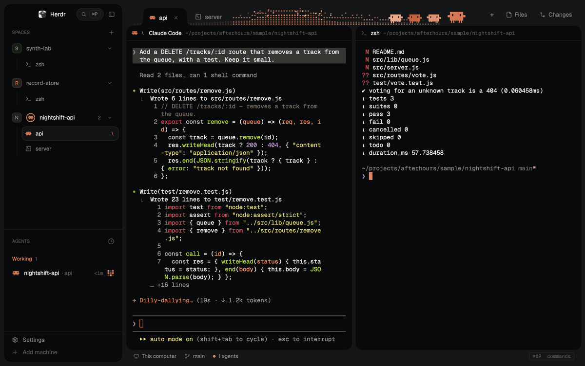
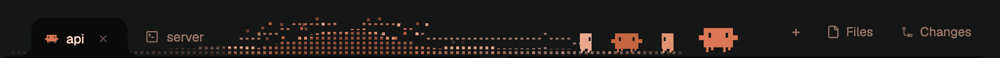
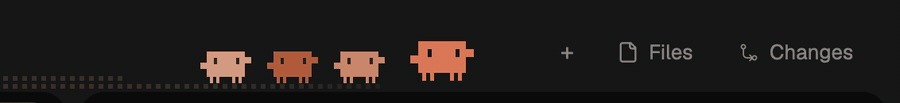
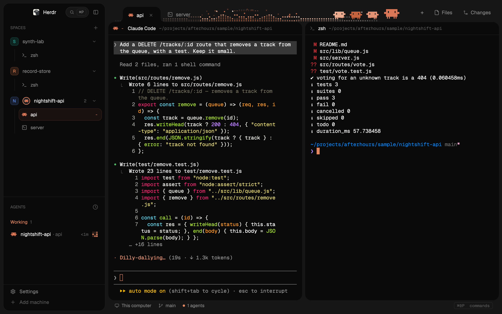

# Afterhours for Herdr

A dark, quiet [Herdr](https://herdr.dev) layout whose tab bar listens to your music. A dot-matrix skyline behind the tabs moves with whatever the Mac is playing, particles hop along it in time with the beat, and a small pixel figure dances at the right end of the bar. When the song builds, its friends join in. When you pause the music, it sits down and smokes a cigarette.



## The bar



- **Skyline.** Bass in the centre, treble falling away to both sides; the left half is the left channel and the right half the right. Deep, medium and pale terracotta, running hotter as the music's drive rises. A dim reflection sits under it, and a bass hit sends a pale line sweeping from the centre to both ends.
- **Particles.** Bass, mid-range and treble hits each throw particles in their own shade. Their arcs peak on the row of the note that is playing, so the tops trace the tune, and every landing falls on the beat. Each leaves a short trail.
- **Dancer.** 21 moves, picked by how driven the music is (a sway for a calm passage, jumping jacks for a chorus), one move per eight beats. Up to three friends join as the drive rises and leave when it falls. They dance on a small stage under a column of light that brightens on the beat.
- **Break.** 2.5 seconds after the sound stops the figure sits down with a cigarette, takes a drag every 6 seconds and breathes out three puffs. After 45 seconds it dozes off until the music comes back.



With no helper built, or on Linux and Windows, the bar shows a dim dotted baseline and everything else works.

## The rest



- **Sidebar.** Spaces with a tinted letter tile, the logos of the agents running in them, and their tabs nested under a guide line. Below, agents grouped by state: Needs you, Working (a pulsing 3×3 dot matrix), Done, Idle. Dragged under 160 px it becomes an icon rail with hover cards.
- **Tabs.** The open tab's surface flows into the pane below it and glides to whichever tab you pick.
- **Panes.** Rounded cards with a header: the program, its folder, a "Needs you" or "Done" badge, and split, zoom and close buttons on hover.
- **Side panel.** Files as a tree after BeUI's file tree (36 px rows, a pill that glides under the pointer, folders that spring open with a guide line, icons tinted by file type), and Herdr's Changes. Remembered per space.
- **Toast.** A rounded card that springs up from the bottom right.
- **Themes.** `afterhours-dark` and `afterhours-light`, following the system. The accent is terracotta `#d2704a`.

The interface follows the look of [BeUI](https://beui.dev)'s components (sidebar, morphing tabs, file tree, badges, toast, loaders), rebuilt with Herdr's own drawing kit.

## Install

Ask your agent in Herdr:

> Add the layout at github.com/iampedii/afterhours

or do it by hand:

1. Copy `layouts/afterhours.json` to `~/.config/herdr-app/layouts/`, both files in `themes/` to `~/.config/herdr-app/themes/`, and every folder in `mods/` to `~/.config/herdr-app/mods/`.
2. For the music (macOS 13 or later, with the Xcode command line tools):

   ```sh
   mkdir -p ~/.config/herdr-app/tools/afterhours-eq
   swiftc -O tools/afterhours-eq/main.swift -o ~/.config/herdr-app/tools/afterhours-eq/afterhours-eq
   ```

   The tab bar starts it by itself. macOS asks once for "Screen & System Audio Recording"; allow it and play something.
3. Switch with `cmd-shift-l`, or run `herdr-app do layout.switch --name afterhours`.

Built and checked on Herdr 0.1.16, macOS. Fonts (Geist, Geist Mono) ship with Herdr.

## What it does on your machine

- `afterhours-tabs` starts `tools/afterhours-eq/afterhours-eq` if you built it, and checks every 30 seconds that it is still running. The helper taps system audio through ScreenCaptureKit, analyses each buffer into 32 frequency bands per channel and drops it: no audio is recorded or stored. It writes one line of numbers to `/tmp/afterhours-eq.levels` about 20 times a second while something plays, and quits when Herdr is gone.
- `afterhours-spaces` runs `git` (read-only) in your space folders and `hc machine ls`.
- `afterhours-files` lists the focused pane's folder with `sh` (PowerShell on Windows), runs `git status` there (read-only) and reads the file you open for its preview.
- Nothing reaches the network.

## The preview

`sample/make.sh` builds the three small projects in the pictures. `sample/poster.py` builds `preview.png` from the two window shots in `sample/frames/`. The recordings are frames from `herdr-app shot`, taken in a second Herdr window with its own home and core session, with real music playing; the break was recorded by feeding the bar silence.

## License

MIT. See [LICENSE](LICENSE).
