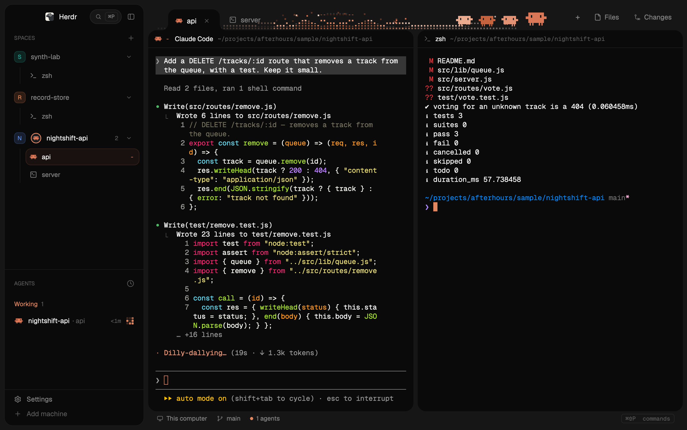

# Afterhours

A dark, rounded workspace whose top bar is a music visualiser. The window is a near-black canvas holding a sidebar card on the left and terminal cards on the right. Behind the tabs runs a dot-matrix skyline in terracotta that moves with the system's audio; particles hop along it on the beat, and a pixel figure dances at its right end, joined by up to three friends as the music builds. When the music pauses the figure sits and smokes a cigarette, then dozes. The interface look follows [BeUI](https://beui.dev). Dark and light themes.

## What you see

Left to right, top to bottom. Colors are the dark theme's.

**Window.** Canvas `#161616`, 8 px padding and 8 px gaps. No titlebar; macOS traffic lights at 12,16. Interface font Geist 13.5 px, terminal font Geist Mono.

**Sidebar card** (268 px, 44 to 480, radius 16, 1 px border `#ffffff12`, fill `#0a0a0a`). Narrower than 160 px it is an icon rail.

- Brand row, 46 px, drags the window: Herdr's mark at 20 px, "Herdr" in weight 600, a search pill (28 px high, radius 14, a magnifier and a `⌘P` keycap), and a 28 px sidebar toggle.
- Spaces (two thirds of the remaining height): a small "SPACES" label with a + button. Each space is a 36 px row: a tinted letter tile in the space's color, overlapping round tiles with the logos of the agents running there (a working one is ringed in `#e2875f`), the name, the number of tabs and a chevron. Unusual git state follows the name in muted text: repo, branch, `↑n` `↓n`. Under an open space its tabs are 32 px rounded rows on a vertical guide line, each with the program's icon, its name and its state. The active tab's row has a warm tint and border. A soft pill glides under the pointer.
- Agents (one third): a small "AGENTS" label with a sort button. Groups "Needs you" (`#ee343b`), "Working" (`#e2875f`), "Done" (`#00be6a`), "Idle" (`#5c5c5c`), each with a count. A row shows the agent's logo, "space · detail", its age, and a state mark: a 3×3 dot matrix whose dots pulse out of step while working, a `!` when blocked, a dot when done, a ring when idle.
- Footer, 69 px, above a 1 px border: "Settings" (an accent dot when an update is ready) and "Add machine" in dim text, 32 px rows.

**Work column.**

- Tab bar, 50 px, drags the window. Tabs sit on the bar 30 px in from the left: the open tab is a 40 px high surface in the pane's color, rounded 14 px on top, curving out at both feet into the pane below; the others are bare 32 px labels (13.5 px, weight 500) with a soft hover. Each has the program's icon and a close × on hover. At the right: a + button, then "Files" and "Changes" buttons (28 px high, radius 8).
- Behind the tabs, across the whole bar up to the right-hand buttons: the equaliser. A skyline of dotted columns (3 px dots, 6 px apart across and 5 px apart down, 6 rows high), bass in the centre and treble falling away to both ends, the left half showing the left channel and the right half the right. Deep `#d2704a` at the centre through `#e3a68f` to pale `#f5e0d7` at the ends, fading out towards the ends and under the tabs. A cap dot rests on each column's recent peak. Particles the size of one dot hop along the skyline. With no sound: a dim dotted baseline.
- At the right end of the skyline, just left of the + button: the dancer, a 40×25 px figure on a 16×10 grid of 2.5 px cells in `#d97757` (a wide body with two eyes, an arm each side, four legs). Up to three friends stand to its left, 42 px apart, at 2 px cells, in `#e39373`, `#c5633f` and `#eaab8f`.
- Panes: cards of radius 16 with an 8 px gap, fill `#0a0a0a`, terminal padding 14. Each has a 34 px header with a 1 px bottom border: program icon 14 px, name at 12.5 px weight 500, the folder in Geist Mono 11.5 px dim (home shown as `~`), then a badge ("Needs you" red with a pulsing dot, or "Done" green), and on hover four 24 px round buttons: split right, split down, zoom, close.
- Side panel (hidden until asked; 368 px, 280 to 900, radius 12, bordered): Herdr's Files or Changes.
- Status bar, 28 px, 12 px muted text: the machine ("This computer"), the branch, a dot and "N agents" (the dot is `#e2875f` while one works), a red "N needs you" pill, and at the right a keycap with the palette's key and "commands".

**Toast.** A 384 px card, radius 16, bottom right: a tinted icon circle, a title, a two-line body and a round close button.

## How it behaves

- Agent status. Working: a spinning `| / - \` before the pane's name and on the tab's sidebar row, the dot matrix in the agents list, a ring on the space's logo tile, an orange dot in the status bar. Blocked: "Needs you" badges in the pane header and status bar, a red group at the top of the agents list. Done: a green "Done" badge and dot. Idle: a grey ring.
- Click a space to open it, drag to reorder, right-click for its menu; the chevron folds its tabs with a spring. Click a tab row or an agent row to go there. The search pill opens the picker; the status bar's keycap opens the palette.
- Clicking a tab moves the surface under it with a glide. The wheel over the bar switches one tab per notch. Files and Changes toggle the side panel, remembered per space.
- The sidebar toggle folds the sidebar to the rail (76 px on macOS, 44 elsewhere) over twelve frames and back to the width it had. On the rail every button opens a hover card: a space's tabs, a stack of worktrees, what a footer button does.
- Music. The skyline follows the audio about 20 times a second; each column's height springs. Tempo is measured from the bass hits. Bass, mid-range and treble hits throw particles in deep, medium and pale terracotta from the centre, middle and ends. A particle leaves bright, hops a few times and cools; each hop lasts a whole number of half beats and peaks on the row the current note's pitch maps to, so the arcs trace the tune and land on the beat. Where one lands, the column's top dot flashes. How many, how far and how fast follow the music's drive (0 to 1): higher pitch, stronger bass and faster tempo against the song's own range over the last minute, plus a short burst on a sudden moment.
- Dancer. It appears when sound starts. A move lasts 8 beats (4 when the drive moves to another set) and comes from a set chosen by the drive: calm (sway, look, nod, wobble, hello, wave), middling (sway, wave, shuffle, stomp, pump, roof, disco, twist, kick, run, bang) and driven (hop, jack, spin, leap, moonwalk, peek, pump, shuffle, roof, disco, run, twist). Parts move on springs timed to the beat; it dips on each beat and jumps on a burst. Friends join one per beat as the drive passes 0.35, 0.5 and 0.65 and leave when it falls a tenth below; each is one step of the move behind the figure to its right, and every other one mirrors it.
- Break. 2.5 s after the sound stops the friends sink away and the lead sits (the body comes down until only the feet show) holding a cigarette in its right hand. Every 6 s it lifts it for a drag, the tip glows, it lowers it and three grey puffs rise and fade. After 45 s the cigarette is gone and it sits with its eyes shut. Sound brings it back up. It never appears in a session that has had no sound.

## Built from

- `layouts/afterhours.json`: `root` row (padding 8, gap 8, background `canvas`, `titlebar: none`) with `sidebar` (column: `brand` 46 px, `sidebar-lists` holding `spaces` weight 2 and `agents` weight 1, `sidebar-footer` 69 px) and `work` (column: `tabs` 50 px, `work-body` row of `main` and the hidden `panel` stack of `files` and `changes`, `status` 28 px). `main` is `{ tab: "active", pane: { gap 8, radius 16, lone: true, header: { mod: afterhours-pane, height 34 } } }`. `toast: afterhours-toast`. Themes `afterhours-dark` and `afterhours-light`.
- `afterhours-workspace-chrome`: the brand row, and with `props: { footer: true }` the footer. Calls `layout.resize`, `mod.open {picker}`, `mod.open {machine-add}`, `app.settings`.
- `afterhours-spaces`: the spaces list and rail. Reads `spaces()`, `panes()`, `agents()`; runs `git rev-parse`, `git symbolic-ref` and `git rev-list --left-right --count` per space folder, and `hc machine ls`. Calls `space.select`, `space.new`, `space.move`, `tab.select`.
- `afterhours-agents`: the agents list (priority or grouped by space, sub-agents as a tree, pins). Calls `pane.focus`, `terminal.pin`, `terminal.peek`.
- `afterhours-tabs`: `main.js` (tabs, panel buttons, window buttons off macOS), `eq.js` (the `Equaliser`), `dancer.js` (the figures). Calls `tab.select`, `tab.close`, `tab.rename`, `tab.move`, `layout.show/hide/select`, `window.*`.
- `afterhours-pane`, `afterhours-workspace-status`, `afterhours-toast` as described above. Shipped mods used: `files`, `changes`, `picker`, `machine-add`, and icons from `mods/workspace-chrome/` and `mods/pane/`.
- `tools/afterhours-eq/main.swift`: a Swift helper (ScreenCaptureKit audio tap, 2048-point FFT at 48 kHz, 32 log-spaced bands from 45 Hz to 15 kHz per channel). About every 45 ms it writes one line of 65 integers 0..100 to `/tmp/afterhours-eq.levels`: left bands bass first, right bands, loudness. One copy at a time (`/tmp/afterhours-eq.lock`); it quits when Herdr is gone. `eq.js` reads the file on a 30 ms timer and runs `pgrep -x afterhours-eq || nohup <home>/tools/afterhours-eq/afterhours-eq &` at start and every 30 s.
- Art: SVG line icons inside the mods; the figures are plain `div`s.

## Watch out

- Mods can animate only opacity, width, height, left and top. No rotation, no color animation, no shaders: color changes are redraws, and the figures are rectangles moved on springs.
- The equaliser is one `div` per column and per particle (180 particles at most), redrawn every 30 ms while sound plays. It costs CPU; with no sound the bar redraws only when the break changes, and not at all once the figure dozes.
- A reused particle must be drawn once at its start before it is given a hop, or it streaks across the bar.
- The first reading after silence is a jump from nothing: learn from it, don't count it as a hit.
- "Live" means the last line has a non-zero number. The helper writes a line of zeros when sound stops and then nothing.
- The helper needs macOS 13 and the "Screen & System Audio Recording" permission, asked once. A rebuilt binary is asked again. Without it the bar stays a dotted baseline and no figure appears.
- A mod cannot import from another mod's folder; `./file.js` inside one works.
- Herdr frames its toast overlay, so `afterhours-toast` reopens itself as a frameless window and closes the framed one.
- The dancer needs the bar to be wider than the tabs plus the right-hand buttons; in a narrow window it is not drawn.

## Done when

- `herdr-app check mods/<name>` passes for all seven mods and `layout.switch {name: "afterhours"}` shows no errors in `herdr-app status`.
- With music playing, the skyline moves, particles hop, and the figure dances; a louder, faster passage brings friends in.
- Pausing the music: within 3 s the figure sits with a cigarette; within 10 s it has taken a drag and puffs have risen; after about 45 s it sits with eyes shut. Playing again stands it up.
- An agent given a task shows the spinner in its pane header, the dot matrix under "Working" and an orange dot in the status bar; when it finishes, a "Done" badge.
- Dragging the sidebar under 160 px shows the rail, and its buttons open hover cards.
